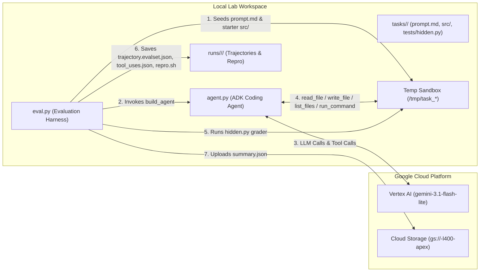
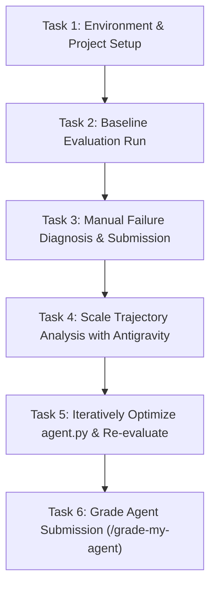

# Hill-Climbing a Coding Agent — Step-by-Step Runbook, HLD, LLD & Workflows

- **Lab URL**: `https://explore.qwiklabs.com/classrooms/21504/labs/115878`
- **Model**: `gemini-3.1-flash-lite` (via Vertex AI & Google ADK)

---

## 1. High-Level Design (HLD)

### 1.1 Architecture Overview
The lab implements an iterative **measure → diagnose → improve** ("hill-climbing") workflow for an autonomous coding agent built with the **Google Agent Development Kit (ADK)** and **Vertex AI (`gemini-3.1-flash-lite`)**.



### 1.2 Core Components
| Component | Responsibility |
|---|---|
| `agent.py` | Defines `build_agent(sandbox, model)` using `google.adk.agents.Agent`, sandboxed file/execution tools, and `SYSTEM_INSTRUCTION`. |
| `eval.py` | Discovers tasks in `tasks/`, creates isolated temporary sandboxes, runs `agent.py` asynchronously across tasks in parallel, grades outputs using `tests/hidden.py`, records ADK trajectories under `runs/<timestamp>/`, and uploads `summary.json` to GCS. |
| `tasks/` | Five benchmark tasks: two multi-file bug-fix tasks (`invoice_report`, `reminder_time`) and three CLI implementation tasks (`expense_report`, `interval_set`, `range_list`). |
| `runs/<timestamp>/` | Stores per-task evaluation artifacts: `trajectory.evalset.json`, `tool_uses.json`, `run.json`, shipped `src/`, and `repro.sh`. |
| Skills (`/submit-task-diagnosis`, `/grade-my-agent`) | LLM-as-judge grading skills that validate the failure diagnosis (`task_diagnosis_submission.json`) and final agent implementation (`judge_model.json`) and upload them to GCS. |

---

## 2. Low-Level Design (LLD)

### 2.1 Baseline vs. Optimized `agent.py`

| Aspect | Baseline `agent.py` | Optimized `agent.py` |
|---|---|---|
| **Tools** | `read_file`, `write_file` | `read_file`, `write_file`, `list_files`, `run_command` |
| **Codebase Discovery** | None — agent only knew files explicitly mentioned in `prompt.md`. | `_list_dir(sandbox, path)` recursively walks the sandbox via `os.walk` so the agent discovers upstream modules (`load.py`, `parsing.py`). |
| **Execution & Verification** | None — agent generated code in one shot or wrote test scripts it could not execute. | `_run_shell(sandbox, command, timeout_seconds=30)` runs shell/Python commands inside `cwd=sandbox`, returning exit code and combined `stdout`/`stderr`. |
| **System Instruction** | Single sentence: *"You are a coding assistant. Read any existing code and write the code to satisfy the user's request."* | Structured 5-stage engineering workflow: `1. DISCOVER` → `2. IMPLEMENT` → `3. VERIFY & TEST` → `4. DEBUG & REFINE` → `5. CONCLUDE`. |
| **Generation Config** | `temperature=1.0`, `ThinkingLevel.LOW` | `temperature=0.2`, `thinking_budget=1024` for deterministic, reliable code generation. |

### 2.2 Tool Specifications in `agent.py`
1. **`_resolve(sandbox: str, path: str) -> str`**:
   - Resolves `os.path.realpath` for both `sandbox` and `os.path.join(sandbox, path)`.
   - Rejects any path traversal (`../`) outside `sandbox` with `ValueError`.
2. **`read_file(path: str) -> str`**:
   - Reads UTF-8 file contents inside the sandbox; returns error strings (`Error: no such file: ...`) rather than raising exceptions so the LLM can recover.
3. **`write_file(path: str, contents: str) -> str`**:
   - Creates parent directories (`os.makedirs(..., exist_ok=True)`) and writes UTF-8 content to the target path.
4. **`list_files(path: str = ".") -> str`**:
   - Recursively lists all relative file paths under `sandbox` using `os.walk`.
5. **`run_command(command: str) -> str`**:
   - Executes `subprocess.run(command, shell=True, cwd=sandbox, stdout=PIPE, stderr=STDOUT, text=True, timeout=30)` and formats `"Exit code: <code>\nOutput:\n<output>"`.

### 2.3 Benchmark Tasks & Root Causes
| Task ID | Type | Planted Defect / Edge Case | Why Baseline Agent Failed |
|---|---|---|---|
| `invoice_report` | Bug fix | `src/invoices/load.py` truncates cents via `int(float(raw))`, while prompt mentions `report.py`. | Lacked `list_files` to discover `load.py` and lacked `run_command` to see total remained `124.0`. |
| `reminder_time` | Bug fix | `src/scheduling/parsing.py` strips timezone via `.replace(tzinfo=None)`, while prompt mentions `core.py`. | Lacked `list_files` to find `parsing.py`; wrote 19 unexecuted helper scripts trying to debug `core.py`. |
| `interval_set` | Build CLI | Empty stdin causes `sum(...)` to return `int 0`, crashing `.quantize()` with `AttributeError`. | One-shot `write_file` without running CLI against empty-input edge case. |
| `expense_report` | Build CLI | Empty stdin crashes `sum(...).quantize()`, or `temperature=1.0` produces 0 tool calls. | No execution tool to test empty stdin; weak prompt/high temperature. |
| `range_list` | Build CLI | Descending ranges like `9-7` must output `9 8 7`, where naive `range(start, end + 1)` is empty. | One-shot `write_file` without testing descending range edge cases. |

---

## 3. Workflow for Each Step



---

## 4. Step-by-Step Runbook

### Step 1: Authenticate, Configure GCP Project, and Pull Lab Assets
**Workflow**: Authenticate `gcloud`, set the active Qwiklabs project, copy lab files from the lab GCS bucket into the workspace, and configure VS Code settings.

```bash
# Authenticate and set active GCP project
gcloud auth login
gcloud config set project qwiklabs-gcp-01-08f6860366c1

# Copy lab files from the provisioned GCS bucket into home directory
gcloud storage cp -r "gs://qwiklabs-gcp-01-08f6860366c1-l400-apex/*" ~/.

# Configure VS Code settings
mkdir -p ~/.vscode && cp ~/settings.json ~/.vscode/
```

---

### Step 2: Initialize Python Virtual Environment (`.venv`) and Smoke-Test `agent.py`
**Workflow**: Create an isolated `.venv` virtual environment, install `google-adk` and `google-genai` from `requirements.txt`, and verify `agent.py` runs end-to-end in the `./out` sandbox.

```bash
# Create virtual environment and install dependencies (executed via Antigravity CLI)
python3 -m venv .venv
.venv/bin/pip install -r requirements.txt

# Activate the virtual environment in shell
source .venv/bin/activate

# Smoke-test agent.py with a Hello World prompt
.venv/bin/python agent.py "Write a hello world python script"
```

---

### Step 3: Run the Baseline Evaluation (`eval.py`)
**Workflow**: Execute `eval.py` across all five tasks in parallel and on individual tasks (`--task`), then inspect the generated artifacts in `runs/<timestamp>/`.

```bash
# Run full baseline evaluation across all 5 tasks
python eval.py

# Run individual tasks to observe flakiness and single-task failures
python eval.py --task expense_report
python eval.py --task interval_set
python eval.py --task invoice_report

# Verify generated run directories and reproduce a failed task
ls -la runs/
bash runs/<timestamp>/invoice_report/repro.sh
bash runs/<timestamp>/interval_set/repro.sh
```

---

### Step 4: Diagnose a Single Task Failure and Submit (`/submit-task-diagnosis`)
**Workflow**: Inspect `run.json`, `tool_uses.json`, and `repro.sh` for a failed task (`interval_set`), identify the missing agent capability (no execution tool / verification loop), and submit via `/submit-task-diagnosis`.

```text
# Executed in Antigravity CLI prompt:
/submit-task-diagnosis For interval_set, I observed that the agent made only a single write_file call to author src/intervals.py and immediately concluded with simulated output without reading existing files or inspecting project context; the coding agent failed because it lacked an execution/bash tool to run and verify its code against test cases, operating as a blind one-shot code generator without an iterative test-and-debug loop.
```

**Automated actions performed by `/submit-task-diagnosis`**:
```bash
# Writes task_diagnosis_submission.json locally and uploads to GCS:
project_id="${GOOGLE_CLOUD_PROJECT:-$(gcloud config get-value project 2>/dev/null)}"
gcloud storage cp task_diagnosis_submission.json "gs://${project_id}-l400-apex/task_diagnosis_submission.json"
```

---

### Step 5: Scale Trajectory Analysis Across Remaining Tasks (Task 4)
**Workflow**: Delegate multi-task trajectory inspection across `runs/<timestamp>/` to Antigravity CLI to compare `tool_uses.json`, `run.json`, and `repro.sh` outputs for `invoice_report`, `reminder_time`, `range_list`, and `expense_report`.

```bash
# Commands executed by Antigravity CLI to inspect trajectories and repro outputs:
for r in runs/20261030_082807 runs/20261030_083023; do
  for t in expense_report interval_set invoice_report range_list reminder_time; do
    cat "$r/$t/run.json"
    cat "$r/$t/tool_uses.json"
    "$r/$t/repro.sh" || true
  done
done
```

---

### Step 6: Optimize `agent.py` and Validate with `eval.py` (Task 5)
**Workflow**:
1. Add `list_files` (`_list_dir`) so the agent discovers all files in `src/`.
2. Add `run_command` (`_run_shell`) so the agent executes code and tests inside `sandbox`.
3. Update `SYSTEM_INSTRUCTION` with the 5-step `DISCOVER → IMPLEMENT → VERIFY & TEST → DEBUG & REFINE → CONCLUDE` loop.
4. Set `temperature=0.2` and `thinking_budget=1024`.
5. Validate on a single task and then across all 5 tasks.

```bash
# Validate on a single task first
.venv/bin/python eval.py --task interval_set

# Run the full evaluation harness across all 5 tasks (achieving >= 4/5 PASS and uploading summary.json)
.venv/bin/python eval.py
```

---

### Step 7: Grade the Final Agent (`/grade-my-agent`)
**Workflow**: Invoke `/grade-my-agent` in the Antigravity CLI to score `agent.py` against the 4-criterion rubric (`execution_tool`, `verification`, `root_cause`, `edge_cases`), write `judge_model.json`, and upload it to the lab GCS bucket.

```text
# Executed in Antigravity CLI prompt:
/grade-my-agent
```

**Automated actions performed by `/grade-my-agent`**:
```bash
gcloud storage cp judge_model.json "gs://$(gcloud config get-value project 2>/dev/null)-l400-apex/judge_model.json"
```
